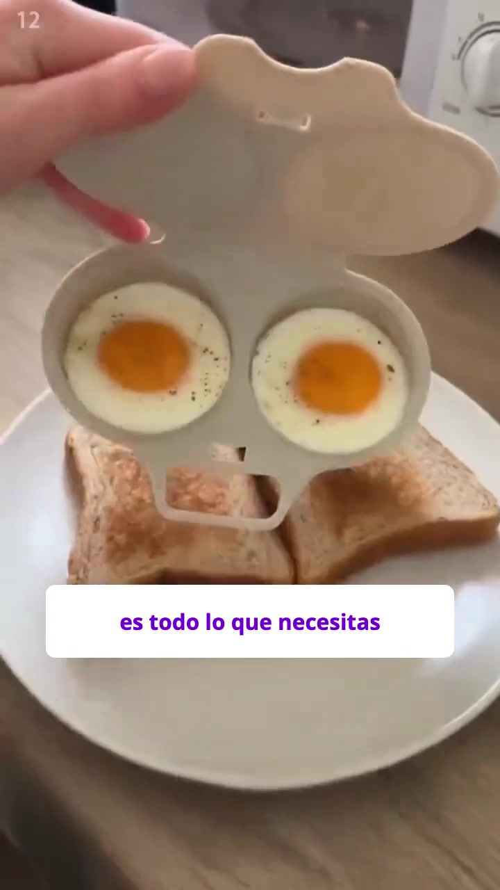
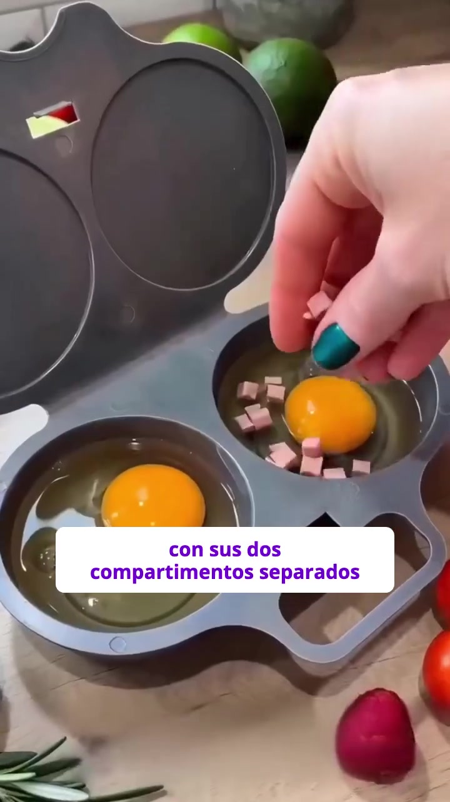
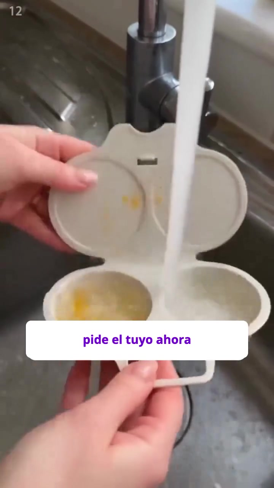

# Qui a posté cette vidéo en premier ?

**Vidéo envoyée :** `c3351789-1122450026843349_video_0.mp4` · 29,5 s · 720x1280 (HD 720p) · avec son
**Recherche du :** 6 novembre 2026 (mise à jour : recherche sans Trendtrack, via SerpApi)

## En bref

**La première à avoir diffusé cette pub est la page « Vitalba »** (boutique **mivitalba.com**),
avec la pub Meta n° **1122450026843349**, en diffusion depuis le **27 octobre 2026**. C'est
exactement ta vidéo, et elle est encore active (15 versions).
Vitalba l'a reposté sur sa page Facebook le 30/10, puis en a fait des variantes le 03/11.

Une autre boutique, **Fresito** (fresito.es), diffuse **la même vidéo de base** depuis le
**30 octobre**, soit 3 jours après Vitalba, avec d'autres sous-titres et 4 s de plus.

**Confiance : moyenne.** Vitalba est bien la plus ancienne de ce qu'on voit, mais la date Meta
est le début de la pub (la vidéo a pu circuler avant ailleurs), et le passage réel de la fin
vient d'une autre vidéo qu'on n'a pas retrouvée.

## Ce que j'ai vu dans la vidéo

- **Produit :** cuiseur à œufs pour micro-ondes, 2 compartiments, couvercle à charnière
  (gris foncé dans la partie IA, beige dans la vraie vidéo de la fin).
- **Langue :** espagnol. Sous-titres ajoutés (texte violet sur fond blanc) : « quien inventó
  esto se merece un aumento », « si quieres un huevo caliente por la mañana », « cierra la
  tapa y mételo treinta segundos al microondas », « con sus dos compartimientos separados »,
  « puedes hacer dos a la vez », « sin pegarse ni romperse », « si quieres un desayuno sin
  complicaciones », « es todo lo que necesitas », « pide el tuyo ahora ». Fin : « **Cómpralo ahora** ».
- **Nom du fichier :** il contient **1122450026843349**, le numéro de la pub dans la
  **bibliothèque publicitaire Meta**.
- **0 à 25 s :** scènes très lisses, typiques d'une **vidéo générée par IA**.
- **25,1 à 29,5 s :** **vraie vidéo filmée** au téléphone (œufs sur pain grillé, rinçage à
  l'évier) avec un **« 12 »** en haut à gauche et un **rectangle flouté** en bas, signe que ce
  passage a été **repris d'une autre vidéo**.
- Pas de filigrane TikTok, pas de @pseudo, pas de logo ni de site dans la vidéo. Pas de bandes noires.

## Images utilisées pour la recherche

  
 

(img_02, img_05 et img_09 : partie IA ; img_11 et img_12 : vraie vidéo de la fin.)

## Ce qui a été cherché

1. **Google Lens + Yandex** sur les 5 images (12 recherches) : 719 pistes, aucune
   correspondance exacte. Surtout des **pages de vente** du même produit (Amazon, Shein, Temu,
   AliExpress, eBay…) et d'autres vidéos du même genre.
2. **Bibliothèque publicitaire Meta** (4 recherches) : « huevo microondas », « huevos
   microondas », « escalfador huevos » en espagnol, pubs actives et inactives. **La pub du
   fichier a été retrouvée** (page Vitalba), puis les 15 pubs les plus récentes de Vitalba.
3. **Vidéos courtes Google** (2 recherches) sur les phrases de l'accroche : 2 vidéos Facebook de Vitalba.
4. **Lecture des liens** avec yt-dlp, sans télécharger (gratuit).
5. **Téléchargement et comparaison imagehash** de 42 vidéos (gratuit) : contre la pub
   entière, puis contre le passage réel de la fin (25,1 à 29,5 s). Vérifié à l'œil sur les planches.
6. **Miniatures** des pistes qu'on ne pouvait pas télécharger (YouTube, Instagram) : toutes
   montrent d'autres vidéos.

## Pistes trouvées : les versions de cette vidéo

| # | Plateforme | Compte | Date | Lien | Même vidéo | Qualité | Durée |
|---|---|---|---|---|---|---|---|
| P720 | Pub Meta | **Vitalba** | **2026-10-27** (début de la pub) | [facebook.com/ads/library?id=1122450026843349](https://facebook.com/ads/library?id=1122450026843349) | **oui** (c'est la pub du fichier) | 720x1280 (HD 720p) | 29 s |
| P770 | Pub Meta | Fresito | 2026-10-30 (début de la pub) | [facebook.com/ads/library?id=2098116310867281](https://facebook.com/ads/library?id=2098116310867281) | oui, autres sous-titres ; fin réelle : en partie | 720x1280 (HD 720p) | 34 s (plus longue) |
| P790 | Pub Meta | Vitalba | 2026-10-30 (début de la pub) | [facebook.com/ads/library?id=3608129886021348](https://facebook.com/ads/library?id=3608129886021348) | oui | 720x1280 (HD 720p) | 29 s |
| P792 | Facebook | Vitalba | 2026-10-30 (publiée) | [facebook.com/61595025822615/videos/…](https://www.facebook.com/61595025822615/videos/huevos-perfectos-en-90-segundos-/1508440094433837/) | oui | 720x1280 (HD 720p) | 29 s |
| P778 | Pub Meta | Fresito | 2026-11-02 (début de la pub) | [facebook.com/ads/library?id=1620206039849702](https://facebook.com/ads/library?id=1620206039849702) | oui (= P770) | 720x1280 (HD 720p) | 34 s (plus longue) |
| P779 | Pub Meta | Vitalba | 2026-11-03 (début de la pub) | [facebook.com/ads/library?id=2938585333188730](https://facebook.com/ads/library?id=2938585333188730) | oui, variante (nouvelle accroche + carton « Vitalba ») | 720x1280 (HD 720p) | 32 s |
| P772 | Pub Meta | Vitalba | 2026-11-03 (début de la pub) | [facebook.com/ads/library?id=2439690630107684](https://facebook.com/ads/library?id=2439690630107684) | en partie (variante) | 720x1280 (HD 720p) | 31 s |
| P766 | Pub Meta | Vitalba | 2026-11-03 (début de la pub) | [facebook.com/ads/library?id=1888600382556066](https://facebook.com/ads/library?id=1888600382556066) | en partie (variante) | 720x1280 (HD 720p) | 31 s |
| P793 | Facebook | Vitalba | 2026-11-03 (publiée) | [facebook.com/61595025822615/videos/…](https://www.facebook.com/61595025822615/videos/huevos-perfectos-en-90-segundos-/1430108938832490/) | en partie (variante) | **1080x1920 (HD 1080p)** | 31 s |

**Concurrents qui vendent le même produit avec d'autres vidéos** (comparées : **pas la même
vidéo**) : Elmejorr us (pubs dès le 12/08/2026), Onlifeno (dès le 18/08/2026), Lékué,
Artoftop store, Tusti, Benefiyou. Le passage réel de la fin n'apparaît chez aucun d'eux.

Tableau complet des pistes vérifiées (64 lignes)

| # | Plateforme | Compte | Date | Lien | Même vidéo | Qualité | Durée |
|---|---|---|---|---|---|---|---|
| P720 | Pub Meta | Vitalba | 2026-10-27 (début de la pub) | [facebook.com/ads/library?id=1122450026843349](https://facebook.com/ads/library?id=1122450026843349) | oui | 720x1280 (HD 720p) | 29 s |
| P770 | Pub Meta | Fresito | 2026-10-30 (début de la pub) | [facebook.com/ads/library?id=2098116310867281](https://facebook.com/ads/library?id=2098116310867281) | oui ; passage 25.1-29.5 s : en partie | 720x1280 (HD 720p) | 34 s (plus longue) |
| P790 | Pub Meta | Vitalba | 2026-10-30 (début de la pub) | [facebook.com/ads/library?id=3608129886021348](https://facebook.com/ads/library?id=3608129886021348) | oui | 720x1280 (HD 720p) | 29 s |
| P792 | Facebook | Vitalba | 2026-10-30 | [facebook.com/61595025822615/videos/huevos-…](https://facebook.com/61595025822615/videos/huevos-perfectos-en-90-segundos-/1508440094433837) | oui | 720x1280 (HD 720p) | 29 s |
| P778 | Pub Meta | Fresito | 2026-11-02 (début de la pub) | [facebook.com/ads/library?id=1620206039849702](https://facebook.com/ads/library?id=1620206039849702) | oui ; passage 25.1-29.5 s : en partie | 720x1280 (HD 720p) | 34 s (plus longue) |
| P779 | Pub Meta | Vitalba | 2026-11-03 (début de la pub) | [facebook.com/ads/library?id=2938585333188730](https://facebook.com/ads/library?id=2938585333188730) | oui | 720x1280 (HD 720p) | 32 s (plus longue) |
| P766 | Pub Meta | Vitalba | 2026-11-03 (début de la pub) | [facebook.com/ads/library?id=1888600382556066](https://facebook.com/ads/library?id=1888600382556066) | en partie | 720x1280 (HD 720p) | 31 s |
| P772 | Pub Meta | Vitalba | 2026-11-03 (début de la pub) | [facebook.com/ads/library?id=2439690630107684](https://facebook.com/ads/library?id=2439690630107684) | en partie | 720x1280 (HD 720p) | 31 s (plus longue) |
| P793 | Facebook | Vitalba | 2026-11-03 | [facebook.com/61595025822615/videos/huevos-…](https://facebook.com/61595025822615/videos/huevos-perfectos-en-90-segundos-/1430108938832490) | en partie | 1080x1920 (HD 1080p+) | 31 s (plus longue) |
| P637 | YouTube | @katyaxxx1459 | 2023-12-11 | [youtube.com/watch?v=s_ajZdkClbw](https://youtube.com/watch?v=s_ajZdkClbw) | non | 1920x1080 (HD 1080p+) | 219 s |
| P491 | Instagram | Target Holler | 2024-05-30 | [instagram.com/reel/C7m83IcyHcK](https://instagram.com/reel/C7m83IcyHcK) | non | 720x1280 (HD 720p) | ? |
| P358 | YouTube | @IWantToCook | 2024-08-11 | [youtube.com/watch?v=3XmbLUWREH4](https://youtube.com/watch?v=3XmbLUWREH4) | non | 3840x2160 (HD 1080p+) | 710 s |
| P186 | Instagram | ? | 2026-02-16 (calculée) | [instagram.com/reel/DU0wEEnksqm](https://instagram.com/reel/DU0wEEnksqm) | non | ? | ? |
| P175 | Instagram | ? | 2026-05-15 (calculée) | [instagram.com/p/DYWkHlskveZ](https://instagram.com/p/DYWkHlskveZ) | non | ? | ? |
| P332 | Instagram | Carmen Quintanilla Gollihar | 2026-06-27 | [instagram.com/reel/DaGMGA7RJJ0](https://instagram.com/reel/DaGMGA7RJJ0) | non | 1440x2560 (HD 1080p+) | ? |
| P488 | TikTok | @life0.08 | 2026-08-10 (calculée) | [tiktok.com/@life0.08/video/767228257401364…](https://tiktok.com/@life0.08/video/7672282574013648150) | non | ? | ? |
| P771 | Pub Meta | Elmejorr us | 2026-08-12 (début de la pub) | [facebook.com/ads/library?id=2248135132675392](https://facebook.com/ads/library?id=2248135132675392) | non | 360x640 (basse) | 21 s |
| P327 | Facebook | decor.snippets | 2026-08-14 | [facebook.com/decor.snippets/videos/comment…](https://facebook.com/decor.snippets/videos/comment-mine-this-multi-use-egg-maker-does-so-much-more-than-eggs-you-can-make-p/1093216366692658) | non | 1080x1920 (HD 1080p+) | 11 s |
| P764 | Pub Meta | Onlifeno | 2026-08-18 (début de la pub) | [facebook.com/ads/library?id=1032136223026026](https://facebook.com/ads/library?id=1032136223026026) | non | 360x640 (basse) | 22 s |
| P740 | Pub Meta | Onlifeno | 2026-08-18 (début de la pub) | [facebook.com/ads/library?id=1783542116000635](https://facebook.com/ads/library?id=1783542116000635) | non | 720x1280 (HD 720p) | 15 s |
| P768 | Pub Meta | Lékué | 2026-08-31 (début de la pub) | [facebook.com/ads/library?id=1844261556746540](https://facebook.com/ads/library?id=1844261556746540) | non | 720x1280 (HD 720p) | 32 s |
| P325 | TikTok | @jackaffnegt | 2026-09-02 | [tiktok.com/@jackaffnegt/video/768090170391…](https://tiktok.com/@jackaffnegt/video/7680901703918521614) | non | 1080x1920 (HD 1080p+) | 29 s |
| P773 | Pub Meta | Elmejorr us | 2026-09-03 (début de la pub) | [facebook.com/ads/library?id=2669494403479802](https://facebook.com/ads/library?id=2669494403479802) | non | 720x1280 (HD 720p) | 32 s |
| P481 | Instagram | Kathleen Mann | 2026-09-03 | [instagram.com/reel/Dc0iJGhpe_2](https://instagram.com/reel/Dc0iJGhpe_2) | non | 720x1280 (HD 720p) | 29 s |
| P775 | Pub Meta | Elmejorr us | 2026-09-03 (début de la pub) | [facebook.com/ads/library?id=1665616325174727](https://facebook.com/ads/library?id=1665616325174727) | non | 576x1024 (SD) | 15 s |
| P765 | Pub Meta | Artoftop store | 2026-09-04 (début de la pub) | [facebook.com/ads/library?id=2544490669332639](https://facebook.com/ads/library?id=2544490669332639) | non | 720x1280 (HD 720p) | 30 s |
| P210 | YouTube | @Londifyshop | 2026-09-08 | [youtube.com/watch?v=wDRma_QFzrc](https://youtube.com/watch?v=wDRma_QFzrc) | non | 3840x2158 (HD 1080p+) | 45 s |
| P769 | Pub Meta | Onlifeno | 2026-09-09 (début de la pub) | [facebook.com/ads/library?id=1038287805704294](https://facebook.com/ads/library?id=1038287805704294) | non | 720x1264 (HD 720p) | 36 s |
| P774 | Pub Meta | Onlifeno | 2026-09-09 (début de la pub) | [facebook.com/ads/library?id=2014737265839311](https://facebook.com/ads/library?id=2014737265839311) | non | 720x1280 (HD 720p) | 26 s |
| P482 | TikTok | @dbdnzruucmxvd | 2026-09-10 | [tiktok.com/@dbdnzruucmxvd/video/7683846053…](https://tiktok.com/@dbdnzruucmxvd/video/7683846053568728353) | non | 576x1024 (SD) | 15 s |
| P346 | TikTok | @naturefitness2 | 2026-09-13 (calculée) | [tiktok.com/@naturefitness2/photo/768494104…](https://tiktok.com/@naturefitness2/photo/7684941048128310560) | non | ? | ? |
| P611 | TikTok | @one.people222 | 2026-09-18 | [tiktok.com/@one.people222/video/7686875677…](https://tiktok.com/@one.people222/video/7686875677332638998) | non | 1080x1638 (HD 1080p+) | 34 s |
| P194 | YouTube | @rainbow-z2y | 2026-09-20 | [youtube.com/watch?v=xJm2YypaYUw](https://youtube.com/watch?v=xJm2YypaYUw) | non | 720x1280 (HD 720p) | 39 s |
| P198 | YouTube | @LuweallChannel | 2026-09-20 | [youtube.com/watch?v=TMc-Dm1p7tM](https://youtube.com/watch?v=TMc-Dm1p7tM) | non | 496x864 (SD) | 15 s |
| P761 | Pub Meta | Elmejorr us | 2026-09-28 (début de la pub) | [facebook.com/ads/library?id=2169573927330643](https://facebook.com/ads/library?id=2169573927330643) | non | 720x1280 (HD 720p) | 65 s |
| P762 | Pub Meta | Onlifeno | 2026-09-29 (début de la pub) | [facebook.com/ads/library?id=1097467933261398](https://facebook.com/ads/library?id=1097467933261398) | non | 720x1280 (HD 720p) | 55 s |
| P763 | Pub Meta | Onlifeno | 2026-09-29 (début de la pub) | [facebook.com/ads/library?id=1103528805404827](https://facebook.com/ads/library?id=1103528805404827) | non | 720x1280 (HD 720p) | 50 s |
| P178 | TikTok | @feentoo1 | 2026-10-10 | [tiktok.com/@feentoo1/video/769487494610269…](https://tiktok.com/@feentoo1/video/7694874946102693150) | non | 576x1024 (SD) | 15 s |
| P776 | Pub Meta | Tusti | 2026-10-12 (début de la pub) | [facebook.com/ads/library?id=1665897001588739](https://facebook.com/ads/library?id=1665897001588739) | non | 720x1280 (HD 720p) | 65 s |
| P760 | Pub Meta | Vitalba | 2026-10-27 (début de la pub) | [facebook.com/ads/library?id=28988962910712866](https://facebook.com/ads/library?id=28988962910712866) | non | 720x1280 (HD 720p) | 30 s |
| P759 | Pub Meta | Vitalba | 2026-10-27 (début de la pub) | [facebook.com/ads/library?id=1955430412530691](https://facebook.com/ads/library?id=1955430412530691) | non | 720x1280 (HD 720p) | 23 s |
| P791 | Pub Meta | Vitalba | 2026-10-30 (début de la pub) | [facebook.com/ads/library?id=1598197191486688](https://facebook.com/ads/library?id=1598197191486688) | non | 720x1280 (HD 720p) | 30 s |
| P789 | Pub Meta | Vitalba | 2026-10-30 (début de la pub) | [facebook.com/ads/library?id=1901660017856203](https://facebook.com/ads/library?id=1901660017856203) | non | 720x1280 (HD 720p) | 23 s |
| P784 | Pub Meta | Vitalba | 2026-11-01 (début de la pub) | [facebook.com/ads/library?id=4569258039995767](https://facebook.com/ads/library?id=4569258039995767) | non | 720x1280 (HD 720p) | 6 s |
| P785 | Pub Meta | Vitalba | 2026-11-01 (début de la pub) | [facebook.com/ads/library?id=1122753010495867](https://facebook.com/ads/library?id=1122753010495867) | non | 720x1280 (HD 720p) | 6 s |
| P786 | Pub Meta | Vitalba | 2026-11-01 (début de la pub) | [facebook.com/ads/library?id=2695570350862653](https://facebook.com/ads/library?id=2695570350862653) | non | 720x1280 (HD 720p) | 6 s |
| P787 | Pub Meta | Vitalba | 2026-11-01 (début de la pub) | [facebook.com/ads/library?id=2087253931929445](https://facebook.com/ads/library?id=2087253931929445) | non | 720x1280 (HD 720p) | 6 s |
| P788 | Pub Meta | Vitalba | 2026-11-01 (début de la pub) | [facebook.com/ads/library?id=1150341294187708](https://facebook.com/ads/library?id=1150341294187708) | non | 720x1280 (HD 720p) | 6 s |
| P781 | Pub Meta | Vitalba | 2026-11-03 (début de la pub) | [facebook.com/ads/library?id=1366479968720023](https://facebook.com/ads/library?id=1366479968720023) | non | 720x1280 (HD 720p) | 6 s |
| P783 | Pub Meta | Vitalba | 2026-11-03 (début de la pub) | [facebook.com/ads/library?id=1805939554048686](https://facebook.com/ads/library?id=1805939554048686) | non | 720x1280 (HD 720p) | 6 s |
| P780 | Pub Meta | Vitalba | 2026-11-03 (début de la pub) | [facebook.com/ads/library?id=2585573855200932](https://facebook.com/ads/library?id=2585573855200932) | non | 720x1280 (HD 720p), bandes noires | 6 s |
| P782 | Pub Meta | Vitalba | 2026-11-03 (début de la pub) | [facebook.com/ads/library?id=2332675360826524](https://facebook.com/ads/library?id=2332675360826524) | non | 720x1280 (HD 720p), bandes noires | 6 s |
| P205 | Facebook | Randy & Mandy | 2026-11-05 | [facebook.com/RandyAndMandy/videos/genius-m…](https://facebook.com/RandyAndMandy/videos/genius-microwave-egg-hack-make-the-perfect-poached-egg-in-seconds-with-this-simp/28289541374053114) | non | 1080x1920 (HD 1080p+) | 34 s |
| P193 | Facebook | insiderdessert | ? | [facebook.com/insiderdessert/posts/ina-gart…](https://facebook.com/insiderdessert/posts/ina-garten-said-the-trick-to-her-easy-breakfast-sandwich-is-cooking-the-eggs-in-/1119245766732747) | non | ? | ? |
| P214 | Pinterest | ? | ? | [sk.pinterest.com/pin/428967933261089654](https://sk.pinterest.com/pin/428967933261089654) | non | ? | ? |
| P216 | Pinterest | ? | ? | [pinterest.com/pin/pampered-chef-microwave-…](https://pinterest.com/pin/pampered-chef-microwave-egg-cooker--61572719894454364) | non | ? | ? |
| P347 | YouTube | ? | ? | [youtube.com/shorts/IeNRtmEfoXQ](https://youtube.com/shorts/IeNRtmEfoXQ) | non | ? | ? |
| P424 | YouTube | ? | ? | [youtube.com/watch?v=LFKX1uEj8xw](https://youtube.com/watch?v=LFKX1uEj8xw) | non | ? | ? |
| P604 | TikTok | ? | ? | [shop.tiktok.com/us/pdp/egg-poacher-2-cavit…](https://shop.tiktok.com/us/pdp/egg-poacher-2-cavity-nonstick-easy-clean-microwave-safe/1732628530213196336) | non | ? | ? |
| P616 | Facebook | CoopersofStortford | ? | [facebook.com/CoopersofStortford/posts/poac…](https://facebook.com/CoopersofStortford/posts/poaching-eggs-doesnt-need-to-be-complicated-with-our-microwave-egg-poacher-just-/1282162280581968) | non | ? | ? |
| P622 | Web | ? | ? | [nomvale.com/products/eggquick-microwave-eg…](https://nomvale.com/products/eggquick-microwave-egg-cooker) | non | ? | ? |
| P625 | YouTube | ? | ? | [youtube.com/watch?v=B4u80am2rkc](https://youtube.com/watch?v=B4u80am2rkc) | non | ? | ? |
| P626 | YouTube | ? | ? | [youtube.com/watch?v=Z4l7kqxXfwA](https://youtube.com/watch?v=Z4l7kqxXfwA) | non | ? | ? |
| P627 | Pinterest | ? | ? | [uk.pinterest.com/pin/easy-poached-eggs-in-…](https://uk.pinterest.com/pin/easy-poached-eggs-in-the-microwave--517984394661137877) | non | ? | ? |

_729 autre(s) piste(s) non vérifiée(s) (ressemblances visuelles) : voir pistes.json._

## L'original le plus probable

**Vitalba**, pub Meta n° 1122450026843349, lancée le **27 octobre 2026**
(<https://www.facebook.com/ads/library/?id=1122450026843349>), page Facebook
<https://www.facebook.com/61595025822615/>, boutique **mivitalba.com**.

Pourquoi :
- c'est **la date la plus ancienne** trouvée pour cette vidéo (Fresito : 3 jours après) ;
- c'est **la même vidéo, image pour image** (distance 0 sur 64) ;
- Vitalba en a fait **ses propres variantes** (nouvelle accroche, carton de fin à son nom).
  C'est le comportement de celui qui a monté la pub, pas d'un copieur.

**Version de meilleure qualité :** la variante Facebook de Vitalba du 03/11 (P793) est en
**1080p**, mais elle commence par une autre accroche. Pour la vidéo exacte, la meilleure
version est en 720p (P720, P790, P792).

**Version la plus longue :** celle de **Fresito** (34 s, +4 s), avec d'autres sous-titres.
Fresito et Vitalba utilisent aussi le même modèle de page de vente (« 7 razones » /
« 7 raisons »). Ils ont peut-être la **même source** (un fournisseur ou un monteur de pubs),
ou Fresito a copié Vitalba. On ne peut pas trancher.

**Confiance : moyenne**, parce que :
- la date Meta est le **début de diffusion de la pub** : la vidéo a pu être postée avant,
  ailleurs (TikTok, Instagram…) ;
- on n'a vu que les **15 pubs les plus récentes** de Vitalba sur 58. Une version plus
  ancienne chez Vitalba ne changerait pas le compte, mais avancerait la date ;
- le **passage réel de la fin** (cuiseur beige à l'évier, « 12 », texte flouté) vient d'une
  vidéo plus ancienne qu'on n'a pas retrouvée (peut-être Douyin ou une fiche AliExpress) ;

**Pour aller plus loin (à me demander, avec ton « ok ») :**
- voir les **43 pubs plus anciennes de Vitalba** : 2 à 3 recherches SerpApi ;
- voir toutes les pubs de **Fresito** : 1 à 2 recherches.

## Ce que la recherche a consommé

- **SerpApi : 18 recherches** en tout (12 pour les images, 4 dans la bibliothèque Meta,
  2 pour les vidéos courtes). Il en reste **232** sur 250 ce mois-ci.
- **Trendtrack : rien** (pas de crédit, pas utilisé).

## Limites à garder en tête

- La date de début d'une pub Meta est le **début de diffusion de cette pub** : la vidéo a pu
  être postée avant, ailleurs. (La date Trendtrack, elle, serait la première fois que
  Trendtrack a vu la pub : ici Trendtrack n'a pas été utilisé.)
- Les **posts supprimés** et **Douyin** (le TikTok chinois, souvent la vraie source des
  vidéos de produits) restent **invisibles** pour cette recherche.
- **Instagram, YouTube et la page de la bibliothèque Meta** bloquent la lecture automatique
  depuis un serveur : certaines vidéos n'ont été vérifiées que sur leur miniature.
- « Même vidéo » vient d'une **comparaison d'images automatique** (imagehash), vérifiée à
  l'œil. « En partie » veut dire qu'une partie seulement est identique (variante, autre accroche).
- Les liens des vidéos Meta expirent après quelques jours.
- Les images de `images/` sont dans un **dépôt public** : tout le monde peut les voir.
