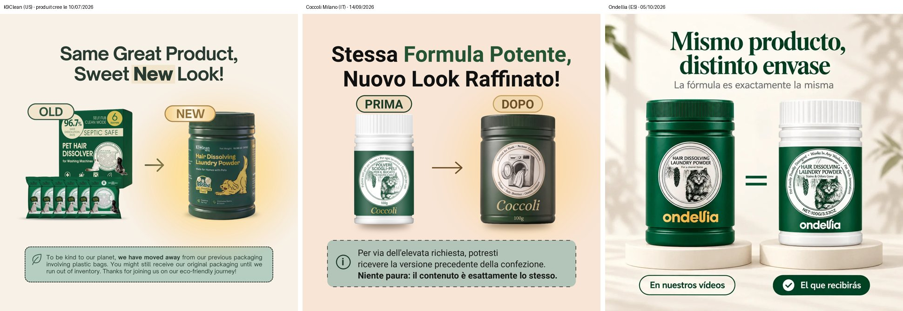

# Qui ont-elles copié ? Trois boutiques de « dissolvant de poils d'animaux »

**Boutiques envoyées :**
1. Ondellia (Espagne) : <https://ondellia.com/products/disolvente-pelo-animal>
2. Coccoli Milano (Italie) : <https://www.coccoli-milano.com/products/coccoli-dissolvente-peli>
3. Bebysh (France / Belgique) : <https://bebysh.com/products/bebysh>

**Produit :** poudre à mettre dans la machine à laver, qui « dissout » les poils de chien et de chat.
**Recherche du :** 7 novembre 2026

## En bref

**La boutique copiée est K9Clean** (**k9clean.shop**, États-Unis) :
<https://k9clean.shop/products/k9clean-hair-dissolver>. Son produit « K9Clean Pet Hair
Dissolver » a été créé le **10 juillet 2026**, soit 2 à 3 mois avant les autres.

La chaîne de copie :

| Ordre | Boutique | Pays | Produit créé le | A copié… |
|---|---|---|---|---|
| 1 | **K9Clean** (k9clean.shop) | 🇺🇸 | **10/07/2026** | (l'original) |
| 2 | **Coccoli Milano** | 🇮🇹 (compte enregistré aux US) | 14/09/2026 | **K9Clean** |
| 3 | **Ondellia** | 🇪🇸 | 05/10/2026 | **K9Clean** (directement) |
| 4 | **Bebysh** | 🇫🇷 🇧🇪 | ? (catalogue protégé) | **Coccoli** (traduit en français) |

**Derrière K9Clean**, le produit lui-même vient très probablement de **Seedshub**, une marque
américaine primée en 2025. Elle vend ce « Pet Hair Dissolver » en boîte verte de 6 sachets, avec
le même chiffre de 96,7 %, et c'est ce que K9Clean montre comme son « ancien emballage ».

**Confiance : élevée** pour « Coccoli et Ondellia ont copié K9Clean » et pour « Bebysh a copié
Coccoli ». **Moyenne** pour « Seedshub est le fabricant ».

## Les preuves

### Coccoli et Ondellia ont traduit les images de K9Clean

| K9Clean 🇺🇸 | Coccoli 🇮🇹 | Ondellia 🇪🇸 |
|---|---|---|
| « **Same Great Product, Sweet New Look!** » OLD → NEW + « vous pourriez encore recevoir notre ancien emballage » | « **Stessa Formula Potente, Nuovo Look Raffinato!** » PRIMA → DOPO + le même avertissement | « **Mismo producto, distinto envase** » : « en nuestros vídeos » → « el que recibirás » |
| « **Add. Wash. Done.** » | « **Aggiungi. Lava. Fatto.** » | « Echa… » (même méthode en 3 étapes) |
| « See the Hair Disappear After Just One Wash » | « Guarda i peli sparire dopo un solo lavaggio » | – |
| « **96.7%** pet hair dissolved » | « Scioglie il **96,7 %** dei peli » | – |
| « Trusted by **10,000+** Customers » | « La fiducia di **12000+** clienti » | – |
| Avis de « **Sofia L.** » | « **Sofia L.** » | – |
| Cadeaux : **Mystery Gift, E-book, Free shipping** | **Sorpresa, Guida della casa serena** (e-book), **Spedizione gratuita** | – |
| « dissolve pet hair at the **molecular** level » | – | « **molecular** » |
| Pot vert « **Hair Dissolving Laundry Powder** » | – | pot vert « **HAIR DISSOLVING LAUNDRY POWDER** » montré « dans nos vidéos » |

Coccoli et Ondellia montrent toutes les deux un **autre pot** (blanc à étiquette verte) comme
« ce que tu recevras » : elles revendent le même produit générique et utilisent les visuels de
K9Clean pour la pub.

### Bebysh a traduit Coccoli (pas K9Clean)

- **26 avis clients sur 33 sont les mêmes**, traduits de l'italien au français : « Nadia R. -
  gatto + labrador » → « Nadia R. - chat + labrador », Chiara M. → Claire M., Antonio G. → Antoine G.,
  Sebastiano P. → Bastien P., Carlotta F. → Charlotte F., Fabio L. → Fabien L., Giulio K. → Julien K.…
- Les **mêmes chiffres** (92 %, 96 %, 50 %) et les **mêmes prix** (24,90 €, 180 €), qu'on ne trouve
  pas chez K9Clean.
- Bebysh propose même un choix de langue « **Italiano** ».

### Ondellia a copié K9Clean, pas Coccoli

Ondellia reprend des éléments de K9Clean (le pot « Hair Dissolving Laundry Powder », « mismo
producto, distinto envase », « molecular »), mais **aucun élément propre à Coccoli** (pas les mêmes
avis, pas les mêmes chiffres : Ondellia annonce 86 % et une garantie de 100 jours).

### Autres indices

- **Coccoli** : images refaites par **IA** le jour même de la création du produit (fichiers
  « hf_20260914_… », format d'un générateur d'images). Thème nommé « Coccoli **v12** ».
- **Ondellia** : thème nommé « Ondellia **v12** », comme Coccoli. C'est peut-être la même personne,
  ou le même modèle de boutique vendu à plusieurs vendeurs (à vérifier).
- **K9Clean** : boutique ouverte en février 2026, produit créé le 10/07/2026, thème « Site Revamp
  Sandbox - Ahmed [June 19, 2026] ». Sa page de vente « 6 Reasons Dog Owners Are Switching… »
  circule dans un **recueil de pages à copier** (une « swipe file ») :
  <https://primalconversions.github.io/listicle-swipes/swipes/k9clean__pages-k9clean-presell-listicle/index.html>.
  C'est sans doute comme ça que les copieurs l'ont trouvée.

## Ce qui a été fait

1. Lecture des pages publiques des 3 boutiques : accueil, produit, catalogue, conditions de vente,
   remboursement, contact (gratuit). Le catalogue de Bebysh est protégé : pas de date pour elle.
2. Repérage des traces : thème, date des produits, noms de fichiers, avis clients, chiffres, prix.
3. Recherche web (outil de Claude, **pas SerpApi**) sur les phrases traduites vers l'anglais
   (« Hair Dissolving Laundry Powder », « 96.7% »…) : elle a mené à K9Clean et à Seedshub.
4. Lecture de la boutique K9Clean et comparaison automatique des 4 boutiques avec le nouvel outil
   `scripts/comparer_boutiques.py`.

## Ce que la recherche a consommé

- **SerpApi : 0 recherche** (il en reste **226** sur 250 ce mois-ci).
- **Trendtrack : rien.**

## Limites à garder en tête

- La date de création d'un produit Shopify peut changer si la boutique recrée sa fiche : c'est
  un bon indice, pas une preuve absolue. Ici, les **traductions mot pour mot** sont la preuve la plus forte.
- La date de Bebysh est inconnue (son catalogue est protégé contre les robots, on n'insiste pas).
- **Seedshub comme fabricant** : déduit de la ressemblance avec l'« ancien emballage » de K9Clean
  et du même chiffre de 96,7 %. Pas vérifié sur la boîte elle-même.
- Une boutique encore plus ancienne, fermée ou non indexée, reste possible. Les **boutiques
  supprimées** et **Douyin** (le TikTok chinois) restent invisibles.
- Pas de comparaison de vidéos ici (aucune vidéo envoyée). On n'a pas regardé leurs pubs Meta :
  c'est possible avec ton « ok » (1 à 3 recherches SerpApi par boutique).
- L'image `images/preuve_meme_image_traduite.jpg` est dans un **dépôt public** : tout le monde peut la voir.
