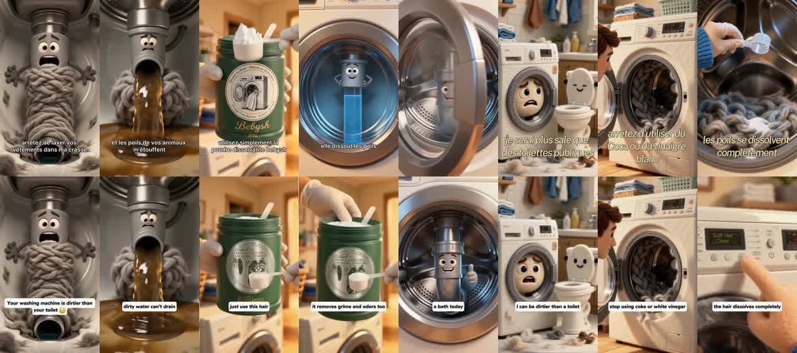
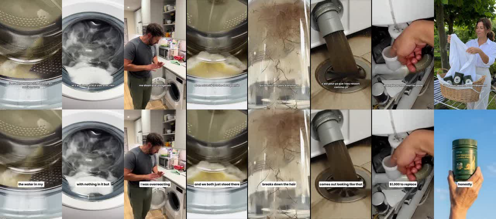

# Pubs Bebysh les plus performantes (actives depuis 48 jours ou plus, au 09/11/2026)

| # | Fichier | Active depuis | Durée | Première phrase | Pub Meta |
|---|---|---|---|---|---|
| 1 | 01_bebysh_157jours_1769808597629515.mp4 | 2026-06-05 (157 j) | 43 s | Votre machine ne nettoie plus. Elle redistribue les poils. Les poils d | https://www.facebook.com/ads/library/?id=1769808597629515 |
| 2 | 02_bebysh_157jours_1273978991195683.mp4 | 2026-06-05 (157 j) | 49 s | Chaque semaine, des propriétaires de chiens et de chats paient entre 2 | https://www.facebook.com/ads/library/?id=1273978991195683 |
| 3 | 03_bebysh_148jours_1660802969378972.mp4 | 2026-06-14 (148 j) | 171 s | Je répare des machines à laver. Et il y a un truc que je vois tellemen | https://www.facebook.com/ads/library/?id=1660802969378972 |
| 4 | 04_bebysh_124jours_915027401621309.mp4 | 2026-07-08 (124 j) | 38 s | Vos draps. Vos serviettes. Le pyjama de vos enfants.  Tout passe dans  | https://www.facebook.com/ads/library/?id=915027401621309 |
| 5 | 05_bebysh_124jours_2194633691121154.mp4 | 2026-07-08 (124 j) | 41 s | On n'a jamais fait ça avant.  3 pots de Bebysh achetés, le 4ème est of | https://www.facebook.com/ads/library/?id=2194633691121154 |
| 6 | 06_bebysh_121jours_1794497354874104.mp4 | 2026-07-11 (121 j) | 140 s | Je répare des machines à laver. Et il y a un truc que je vois tellemen | https://www.facebook.com/ads/library/?id=1794497354874104 |
| 7 | 07_bebysh_115jours_1276722927708959.mp4 | 2026-07-17 (115 j) | 43 s | Pendant des mois, il m'a sorti la même phrase. « Notre machine va très | https://www.facebook.com/ads/library/?id=1276722927708959 |
| 8 | 08_bebysh_109jours_28536301585971519.mp4 | 2026-07-23 (109 j) | 66 s | Cette vidéo c'est exactement ce que me racontent 8 propriétaires de ch | https://www.facebook.com/ads/library/?id=28536301585971519 |
| 9 | 09_bebysh_93jours_4685510805016918.mp4 | 2026-08-08 (93 j) | 43 s | « Notre machine va très bien, arrête de regarder ces vidéos. » Voilà c | https://www.facebook.com/ads/library/?id=4685510805016918 |
| 10 | 10_bebysh_76jours_1064454706311542.mp4 | 2026-08-25 (76 j) | 90 s | J'avais un chat depuis 4 ans.  Au début c'était pas un problème. Les p | https://www.facebook.com/ads/library/?id=1064454706311542 |
| 11 | 11_bebysh_76jours_27575624632114971.mp4 | 2026-08-25 (76 j) | 67 s | J'aurais aimé savoir ça avant de gâcher des mois à laver le linge de m | https://www.facebook.com/ads/library/?id=27575624632114971 |
| 12 | 12_bebysh_74jours_1384432503884060.mp4 | 2026-08-27 (74 j) | 82 s | 9 pannes sur 10 que je repare, c'est pas la machine. C'est ce qu'il y  | https://www.facebook.com/ads/library/?id=1384432503884060 |
| 13 | 13_bebysh_74jours_952480014546792.mp4 | 2026-08-27 (74 j) | 51 s | J'ai 2 chiens et j'ai honte de dire que je viens d'apprendre ca.  Pend | https://www.facebook.com/ads/library/?id=952480014546792 |
| 14 | 14_gwenaelle_59jours_1437464908284932.mp4 | 2026-09-11 (59 j) | 50 s | Si t'as un chien ou un chat à la maison, il faut que je te raconte ce  | https://www.facebook.com/ads/library/?id=1437464908284932 |
| 15 | 15_gwenaelle_57jours_2179124833486363.mp4 | 2026-09-13 (57 j) | 121 s | Mon chien dort dans mon lit, sur le canapé, et sur à peu près toutes l | https://www.facebook.com/ads/library/?id=2179124833486363 |
| 16 | 16_bebysh_57jours_2288520271999424.mp4 | 2026-09-13 (57 j) | 14 s | Si tu hésitais, c'est maintenant.  L'offre de rentrée Bebysh est sur l | https://www.facebook.com/ads/library/?id=2288520271999424 |
| 17 | 17_bebysh_57jours_940603552424505.mp4 | 2026-09-13 (57 j) | 60 s | Tu as un chien ? Alors vérifie ces trois trucs. Si tu en coches un seu | https://www.facebook.com/ads/library/?id=940603552424505 |
| 18 | 18_bebysh_57jours_1406726580794490.mp4 | 2026-09-13 (57 j) | 124 s | Voilà ce qui arriverait si un maître de chien prenait enfin correcteme | https://www.facebook.com/ads/library/?id=1406726580794490 |
| 19 | 19_bebysh_54jours_2612305475893674.mp4 | 2026-09-16 (54 j) | 64 s | Tu connais cette odeur ?  Celle qui apparaît sur ton t-shirt au bout d | https://www.facebook.com/ads/library/?id=2612305475893674 |
| 20 | 20_bebysh_51jours_1092238926861869.mp4 | 2026-09-19 (51 j) | 323 s | Si t'as un chien ou un chat à la maison, lis ça jusqu'au bout. Ce que  | https://www.facebook.com/ads/library/?id=1092238926861869 |
| 21 | 21_bebysh_48jours_1741043537588765.mp4 | 2026-09-22 (48 j) | 66 s | J'ai fait le test que personne ne fait : deux machines identiques, deu | https://www.facebook.com/ads/library/?id=1741043537588765 |

Signaux de performance utilisés : pub encore active, ancienneté (jours de diffusion). Meta ne publie pas les dépenses ; la couverture (vues) des pubs européennes se lit sur la page de chaque pub (« Transparence de la publicité dans l'UE »).

## Bonus : pubs K9Clean (USA, en anglais) les plus anciennes encore actives (au 09/11/2026)

| # | Fichier | Active depuis | Durée | Image | Texte de la pub (début) | Pub Meta |
|---|---|---|---|---|---|---|
| 1 | 01_k9clean_252jours_905600842437759.mp4 | 2026-03-02 (252 j) | 192 s | 720x1280 | Tired of pet hair everywhere? 🐶🐾 It’s not just your clothes — it’s you | https://www.facebook.com/ads/library/?id=905600842437759 |
| 2 | 02_k9clean_211jours_1737015387705519.mp4 | 2026-04-12 (211 j) | 151 s | 720x1280 | Tired of pet hair everywhere? 🐶🐾 It’s not just your clothes — it’s you | https://www.facebook.com/ads/library/?id=1737015387705519 |
| 3 | 03_k9clean_178jours_1739409830740883.mp4 | 2026-05-15 (178 j) | 144 s | 720x1280 | Tired of pet hair everywhere? 🐶🐾 It’s not just your clothes — it’s you | https://www.facebook.com/ads/library/?id=1739409830740883 |
| 4 | 04_k9clean_170jours_1520291343070477.mp4 | 2026-05-23 (170 j) | 46 s | 720x1280 | Tired of pet hair everywhere? 🐶🐾 It’s not just your clothes — it’s you | https://www.facebook.com/ads/library/?id=1520291343070477 |
| 5 | 05_k9clean_170jours_1489789596117970.mp4 | 2026-05-23 (170 j) | 42 s | 720x1280 | Tired of pet hair everywhere? 🐶🐾 It’s not just your clothes — it’s you | https://www.facebook.com/ads/library/?id=1489789596117970 |
| 6 | 06_k9clean_157jours_1573366104363015.mp4 | 2026-06-05 (157 j) | 41 s | 720x1280 | Tired of pet hair everywhere? 🐶🐾 It’s not just your clothes — it’s you | https://www.facebook.com/ads/library/?id=1573366104363015 |
| 7 | 07_k9clean_139jours_946558918417739.mp4 | 2026-06-23 (139 j) | 48 s | 720x1280 | Tired of pet hair everywhere? 🐶🐾 It’s not just your clothes — it’s you | https://www.facebook.com/ads/library/?id=946558918417739 |
| 8 | 08_k9clean_100jours_2025569754826776.mp4 | 2026-08-01 (100 j) | 46 s | 720x1280 | Tired of pet hair everywhere? 🐶🐾 It’s not just your clothes. It’s your | https://www.facebook.com/ads/library/?id=2025569754826776 |
| 9 | 09_k9clean_61jours_1360713082809476.mp4 | 2026-09-09 (61 j) | 110 s | 720x1280 | Tired of pet hair everywhere? 🐶🐾 It’s not just your clothes — it’s you | https://www.facebook.com/ads/library/?id=1360713082809476 |

Page : K9Clean / K9Clean Pets (k9clean.shop, k9cleanpets.com), la boutique américaine que Bebysh, Coccoli et Ondellia ont copiée.

Ces 9 vidéos sont **en anglais** : ce sont les versions d'origine, à traduire en français.
K9Clean vise surtout les États-Unis (pas l'Europe), mais c'est la boutique que tout le monde copie.

## Bebysh traduit les pubs de K9Clean

Comparaison d'images automatique (1 image par seconde) :

| Pub Bebysh (FR) | = traduction de la pub K9Clean (EN) | Images communes |
|---|---|---|
| n° 1 (1769808597629515, depuis le 05/06) | n° 5 (1489789596117970) | 53 % (animation refaite avec le pot Bebysh) |
| n° 9 (4685510805016918, depuis le 08/08) | n° 8 (2025569754826776) | 60 % (mêmes images, sous-titres traduits) |

Les 19 autres pubs Bebysh ne ressemblent à aucune de ces 9 pubs K9Clean : soit Bebysh les a
créées, soit elles viennent de pubs K9Clean plus anciennes ou arrêtées (pas vérifié).

## Comment elles ont été choisies

- Vendeurs européens de la poudre « dissolvant de poils » déjà trouvés (Bebysh, APWAL, Vyda,
  Poil de Rien, Coccoli, Ondellia, Reinhab, Kovah…), pubs **vidéo** de la bibliothèque Meta.
- Gardées : les pubs **encore actives le 09/11/2026** et diffusées depuis **48 jours ou plus**.
  Une pub qui tourne aussi longtemps est en général rentable (sinon le vendeur la coupe).
- Doublons enlevés (même fichier vidéo publié plusieurs fois). Il reste **21 vidéos**, toutes
  de **Bebysh** (dont 2 publiées sous la page « Gwenaelle »). Les autres vendeurs n'avaient pas
  de vidéo active aussi ancienne.
- Les vidéos (720p, 295 Mo au total) ne sont **pas dans le dépôt** : elles ont été envoyées directement.

## Ce que la recherche a consommé

- **SerpApi : 0 recherche de plus** (données Meta déjà récupérées les 08 et 09/11). Il en reste **186** sur 250.
- **Trendtrack : rien** (pas de crédit jusqu'au 23/11).

## Limites à garder en tête

- **Dépense (70 €/jour)** : Meta ne la publie pas pour les pubs de produits. Impossible à
  vérifier ici. Trendtrack l'estime (crédits de retour le 23/11).
- **Vues (400 000)** : pas donnée par SerpApi. Pour une pub diffusée en Europe, Meta affiche la
  « couverture » sur la page de la pub (lien ci-dessus → « Transparence de la publicité dans
  l'UE »). C'est à regarder à la main, pub par pub.
- La date de début est le **début de diffusion de cette pub** : la vidéo a pu exister avant ailleurs.
- « Active depuis longtemps » est un **bon indice** de rentabilité, pas une preuve.
- Ces pubs sont **déjà en français** : ce sont celles d'un concurrent direct (Bebysh).
- « Traduction » repose sur une comparaison d'images automatique, vérifiée à l'œil sur les 2 paires.
- Les images `images/` sont dans un **dépôt public** : tout le monde peut les voir.

