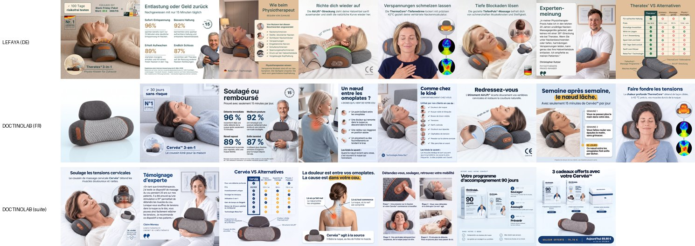
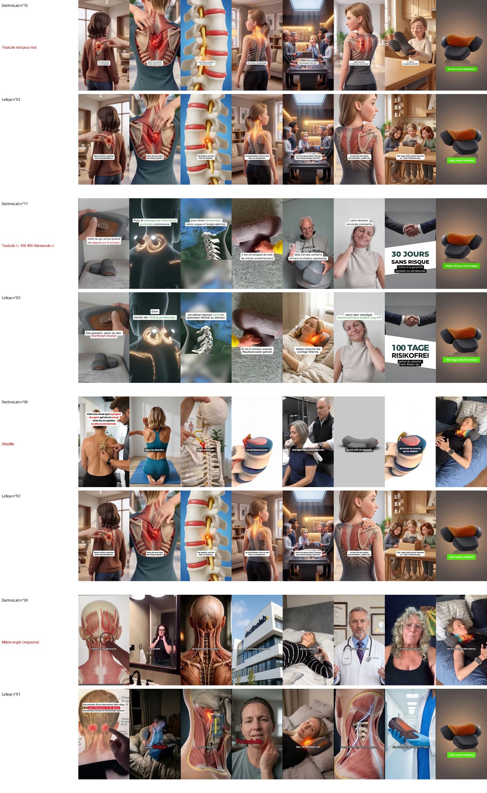
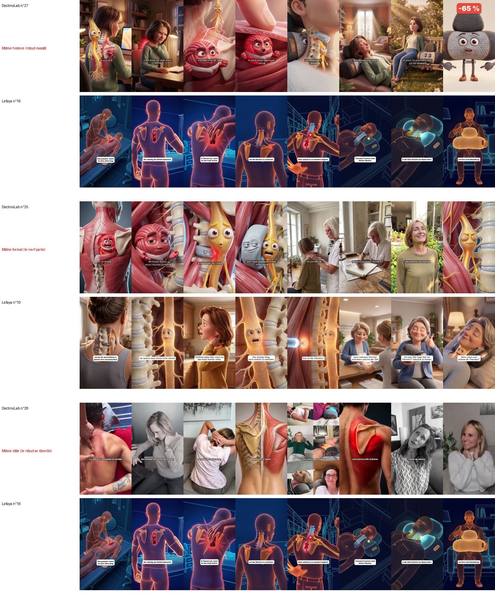

# Masseur cervical 3-en-1 : les pubs qui respectent les critères (DoctinoLab 🇫🇷 et Lefaya 🇩🇪)

**Date :** 13 novembre 2026.
- Original allemand : **Lefaya**, produit **Theratex®** (99 €) : <https://lefaya.de/products/theratex>
- Concurrent français : **DoctinoLab**, produit **Cervéa™** (69,90 €, produit créé le 13/10/2026, images IA du 19/10) :
  <https://doctinolab.fr/products/cervea-appareil-de-massage-cervical-3-en-1>

**Critères :** plus de 400 000 vues (active ou non), **ou** active et plus de 70 €/jour pendant plus de 5 jours.

## En bref

- **28 pubs passent les critères** : **7 de DoctinoLab** (toutes actives) et **21 de Lefaya**. Toutes sont des vidéos **longues** (1 min 40 à 4 min 50).
- **DoctinoLab a traduit les pubs de Lefaya** : 2 vidéos sont les mêmes (juste traduites), 5 ont été remontées avec d'autres images. Preuves dans ses propres vidéos : « plus de 106 400 **Allemands**
  utilisent déjà Cervea » (pub 1726414191754664) et « un groupe de kinés et d'ingénieurs **allemands** » (pub 1801338641065285).
- **DoctinoLab dépense beaucoup en ce moment** : sa meilleure pub (1,8 M de vues en 25 jours) est à environ **890 €/jour** cette semaine.
- Lefaya : ses 21 pubs ne sont que **10 vidéos** différentes (une même vidéo tourne sous 7 pubs). Sa meilleure : **10,4 M de vues**.

## Qu'est-ce que DoctinoLab a copié ? (vérifié à l'œil, image par image)

| Élément | Copié de Lefaya ? | Détail |
|---|---|---|
| **Textes des pubs** | **Oui, tous** | 2 traduits mot pour mot (n° 15, n° 11 : « Allemands » oublié), les 5 autres reprennent les mêmes histoires, chiffres et phrases. |
| **Photos du site** | **Oui, refaites à l'identique** | Mêmes mises en page et mêmes chiffres (96 %, 92 %, 89 %, 87 %), même tableau « VS Alternatives », « Wie beim Physiotherapeut » → « Comme chez le kiné », « Expertenmeinung » → « Témoignage d'experte », même photo de chaleur à 42 °C. Regénérées par IA (fichiers « hf_20261019… »). En plus, à lui : « Un nœud entre les omoplates ? », « Semaine après semaine », programme 90 jours, 3 cadeaux. |
| **Vidéo n° 15** (586 000 vues) | **Oui : la même vidéo** | Mêmes images que Lefaya n° 02, voix et sous-titres traduits. |
| **Vidéo n° 11** (737 000 vues) | **Oui : la même vidéo** | Mêmes images que Lefaya n° 03, 1 ou 2 plans changés, « 100 Tage » → « 30 jours ». |
| **Vidéo n° 06** (1,8 M de vues) | Texte oui, images **non** | Nouveau montage (vraies personnes, disque en 3D) sur le texte de Lefaya n° 02. |
| **Vidéo n° 26** (251 000 vues) | Idée oui, images **non** | Nouveau montage (bâtiment « DoctinoLab », médecin, témoignages) sur l'angle migraine de Lefaya n° 01. |
| **Vidéos n° 25 et 27** (280 000 et 223 000 vues) | Idée oui, images **non** | Nouveaux dessins animés : le nœud et le nerf qui parlent (idée de Lefaya n° 10 et n° 16). |
| **Vidéo n° 28** (144 000 vues) | Idée oui, images **non** | Nouveau montage (vraies personnes + anatomie) sur l'idée de Lefaya n° 16. |

**Correction :** la comparaison automatique d'images n'avait pas vu que les vidéos n° 15 et n° 11 sont les mêmes que celles de
Lefaya, car les sous-titres (au milieu de l'image) changent avec la langue. Vérifié à l'œil sur les images ci-dessous.

Les images de `images/` sont dans un **dépôt public** : tout le monde peut les voir.

## Par angle

| Angle | Pubs | Vidéos différentes | Meilleure pub (vues) | Plus de 400 000 vues | Actives | Plus de 70 €/jour et active | Lefaya / DoctinoLab |
|---|---|---|---|---|---|---|---|
| **A.** « Ce nœud entre les omoplates n'est pas un muscle, c'est un nerf coincé dans le cou » | 9 | 8 | 7 266 981 | 5 | 9 | 9 | 4 / 5 |
| **B.** « Ce n'est pas une migraine » : les maux de tête qui viennent de la nuque (nerf occipital) | 11 | 5 | 10 361 281 | 9 | 11 | 7 | 10 / 1 |
| **D.** La démonstration : « voilà ce qui se passe quand vous vous allongez 15 minutes dessus » | 4 | 2 | 3 616 671 | 4 | 3 | 2 | 3 / 1 |
| **E.** L'histoire du fondateur (« un homme seul contre l'industrie de la santé ») | 2 | 1 | 725 879 | 2 | 1 | 1 | 2 / 0 |
| **F.** Le kiné raconte une patiente (« Sabine, 50 ans, en télétravail ») | 1 | 1 | 1 118 187 | 1 | 1 | 0 | 1 / 0 |
| **G.** Beauté / anti-âge : le muscle du cou qui donne un double menton et fait vieillir | 1 | 1 | 321 886 | 0 | 1 | 1 | 1 / 0 |

**À retenir :**

- Le fil rouge de presque toutes les pubs : **« la douleur n'est pas là où vous croyez, c'est un nerf coincé dans le cou »**,
  puis **« les kinés utilisent 3 méthodes (étirement à 39°, chaleur à 42°, vibrations) ; l'appareil fait les 3 en 15 minutes par jour »**,
  puis le prix des séances de kiné (80 à 120 €), la garantie et le stock limité.
- **Angle B (les maux de tête / « ce n'est pas une migraine »)** est le plus gros de Lefaya (10 pubs, 10,4 M de vues),
  mais DoctinoLab ne l'utilise qu'**une fois** : place à prendre en France.
- **Angles E, F et G** (fondateur, patiente du kiné, beauté / double menton) : **seulement chez Lefaya**, jamais traduits par DoctinoLab.
  L'angle G (beauté) est récent et dépense déjà environ 215 €/jour.
- **Format qui monte** : le nerf ou le nœud qui **parle** (« Je suis le nerf de votre cou »). DoctinoLab a lancé 2 pubs de ce type
  il y a 9 jours, déjà à 280 000 et 220 000 vues.

## Les 7 pubs de DoctinoLab (France) — priorité

| N° fichier | Angle | Format | Durée | Vues | Depuis | € / jour (7 j) | Vient de | Pub Meta |
|---|---|---|---|---|---|---|---|---|
| 06 | A | explication + images d'anatomie | 243 s | 1 792 277 | 2026-10-19 (25 j) | 887 € | Lefaya n° 02 (adaptée) | https://www.facebook.com/ads/library/?id=1421745652862755 |
| 11 | D | démonstration du produit | 103 s | 736 723 | 2026-10-15 (29 j) | 454 € | Lefaya n° 03 (traduite) | https://www.facebook.com/ads/library/?id=1726414191754664 |
| 15 | A | explication + images d'anatomie | 173 s | 586 362 | 2026-10-15 (29 j) | 458 € | Lefaya n° 02 (traduite mot pour mot) | https://www.facebook.com/ads/library/?id=1801338641065285 |
| 25 | A | le nœud et le nerf parlent | 220 s | 279 644 | 2026-11-04 (9 j) | 360 € | Lefaya n° 10 et 16 (le nerf qui parle) | https://www.facebook.com/ads/library/?id=818273581380994 |
| 26 | B | explication + témoignages | 228 s | 251 392 | 2026-10-19 (25 j) | 188 € | Lefaya n° 01 / 08 (nerf occipital) | https://www.facebook.com/ads/library/?id=4224084744392258 |
| 27 | A | le nerf parle (« Je suis le nerf de votre cou ») | 197 s | 223 185 | 2026-11-04 (9 j) | 287 € | Lefaya n° 16 (le nœud massé 3 ans) | https://www.facebook.com/ads/library/?id=1650780870025284 |
| 28 | A | explication + images d'anatomie (IA) | 207 s | 144 090 | 2026-10-19 (25 j) | 87 € | Lefaya n° 16 (même idée) | https://www.facebook.com/ads/library/?id=1381836733734179 |

## Les 21 pubs de Lefaya (Allemagne)

| N° fichier | Vidéo | Angle | Format | Durée | Vues | Active | € / jour (moyenne / 7 j) | Pub Meta |
|---|---|---|---|---|---|---|---|---|
| 01 | L1 | B | explication + images d'anatomie | 196 s | 10 361 281 | oui | 501 € / 159 € | https://www.facebook.com/ads/library/?id=1365963538689224 |
| 05 | L1 | B | idem 01 | 196 s | 1 879 976 | oui | 90 € / 14 € | https://www.facebook.com/ads/library/?id=974346368467997 |
| 07 | L1 | B | idem 01 | 196 s | 1 523 184 | oui | 74 € / 19 € | https://www.facebook.com/ads/library/?id=988312837469900 |
| 23 | L10 | G | beauté, muscle SCM | 104 s | 321 886 | oui | 69 € / 215 € | https://www.facebook.com/ads/library/?id=1439887934702445 |
| 08 | L1b | B | idem 01, autre accroche (« 70 % des maux de tête… ») | 196 s | 1 510 792 | oui | 216 € / 25 € | https://www.facebook.com/ads/library/?id=1587156379431202 |
| 14 | L1b | B | idem 08 | 196 s | 634 614 | oui | 91 € / 4 € | https://www.facebook.com/ads/library/?id=2159393168792349 |
| 19 | L1b | B | idem 08 | 196 s | 462 442 | oui | 50 € / 6 € | https://www.facebook.com/ads/library/?id=4389370477972379 |
| 21 | L1b | B | idem 08 | 196 s | 411 223 | oui | 44 € / 0 € | https://www.facebook.com/ads/library/?id=1601798541350435 |
| 17 | L2 | B | même texte que 01, autres images | 176 s | 533 323 | oui | 35 € / 1 € | https://www.facebook.com/ads/library/?id=1041626478405021 |
| 20 | L2 | B | idem 17 | 176 s | 419 532 | oui | 28 € / 3 € | https://www.facebook.com/ads/library/?id=2054965448427058 |
| 22 | L3 | B | le nerf parle (« Ce n'était jamais une migraine. C'est moi ») | 192 s | 388 770 | oui | 65 € / 71 € | https://www.facebook.com/ads/library/?id=2523627791473584 |
| 02 | L4 | A | explication + images d'anatomie | 166 s | 7 266 981 | oui | 896 € / 404 € | https://www.facebook.com/ads/library/?id=1078287648491377 |
| 16 | L5 | A | récit « 3 ans à masser un nœud » | 116 s | 547 380 | oui | 235 € / 273 € | https://www.facebook.com/ads/library/?id=1116368850760846 |
| 24 | L5 | A | idem 16 | 116 s | 285 012 | oui | 321 € / 366 € | https://www.facebook.com/ads/library/?id=1687012566546416 |
| 10 | L6 | A | le nerf parle (« Je suis responsable du fourmillement dans ton bras ») | 157 s | 859 809 | oui | 143 € / 30 € | https://www.facebook.com/ads/library/?id=1349285410352672 |
| 03 | L7 | D | démonstration du produit | 100 s | 3 616 671 | oui | 458 € / 319 € | https://www.facebook.com/ads/library/?id=1063161353117594 |
| 04 | L7 | D | idem 03 | 100 s | 2 893 903 | non | 389 € / 0 € | https://www.facebook.com/ads/library/?id=1609868746749307 |
| 18 | L7 | D | idem 03 | 100 s | 497 934 | oui | 63 € / 43 € | https://www.facebook.com/ads/library/?id=1415520370488200 |
| 12 | L8 | E | histoire du fondateur | 134 s | 725 879 | oui | 95 € / 56 € | https://www.facebook.com/ads/library/?id=1066992412738421 |
| 13 | L8 | E | idem 12 | 134 s | 663 439 | non | 146 € / 0 € | https://www.facebook.com/ads/library/?id=1381949637080640 |
| 09 | L9 | F | le kiné raconte « Sabine » | 291 s | 1 118 187 | oui | 50 € / 0 € | https://www.facebook.com/ads/library/?id=940776398596679 |

« Vidéo » : les pubs avec le même code utilisent la même vidéo (comparaison d'images automatique ; 2 paires sont même le même fichier exact).

## Ce que la recherche a consommé

- **Trendtrack : 150 crédits** (5 recherches). Il en restait 162 069 avant.
- **SerpApi : 0.** Transcription et comparaison des vidéos : gratuites (outils sur le serveur).

## Limites

- Vues = Europe seulement (transparence Meta). Dépense = estimation Trendtrack (environ 9 € pour 1 000 vues), pas la vraie dépense.
- Lefaya a 1 686 pubs en tout et DoctinoLab 301 : on a lu les 40 plus vues de Lefaya, les 20 plus vues de DoctinoLab,
  et les 20 qui montent le plus cette semaine pour chacune. Une petite pub récente a pu échapper au critère « 70 €/jour ».
- Les angles sont classés d'après le texte parlé (transcription automatique, quelques mots peuvent être faux).
- Les vidéos ne sont pas dans le dépôt : elles ont été envoyées directement.
