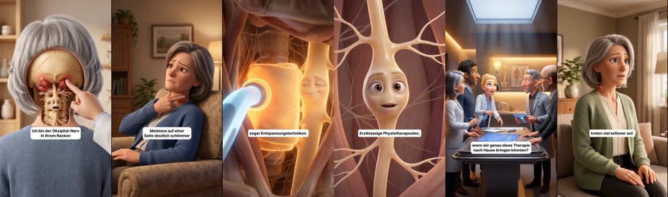
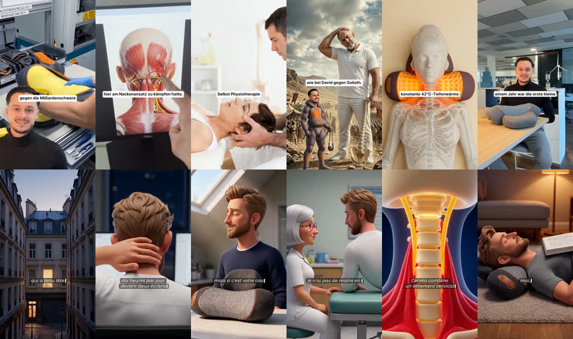
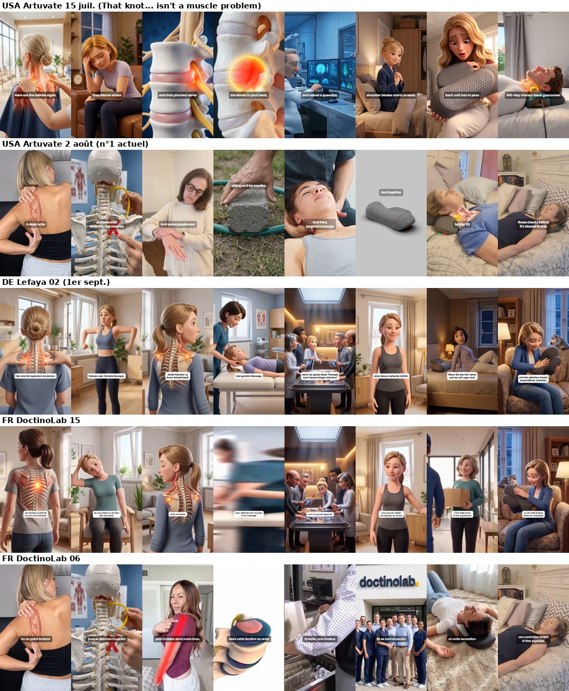
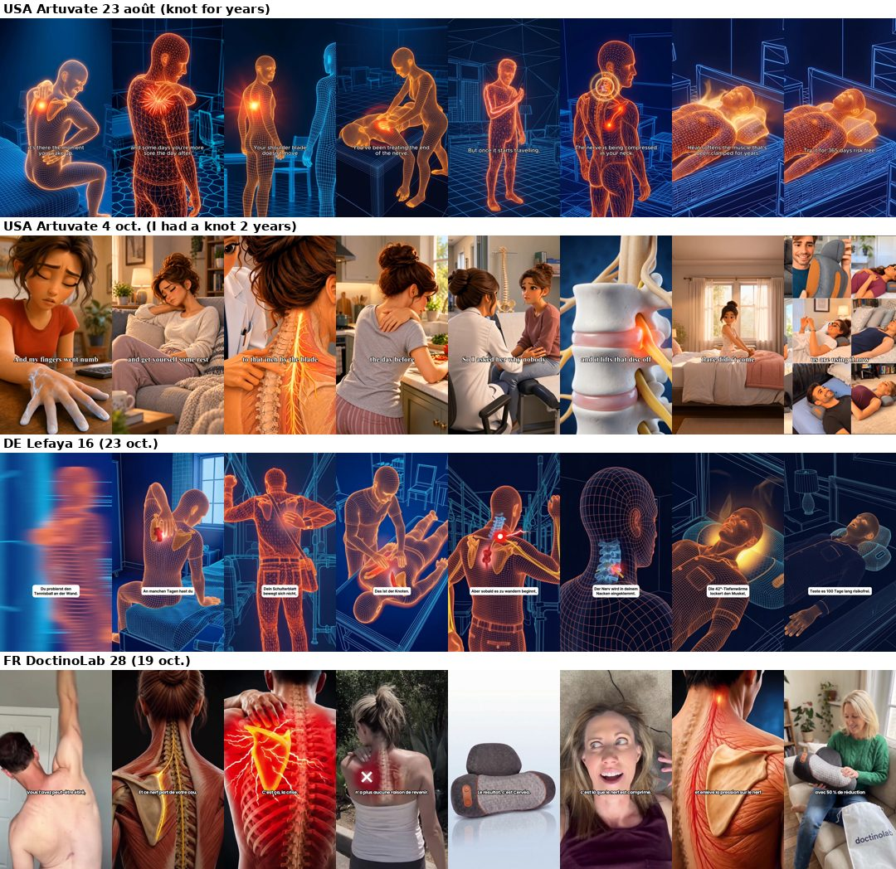
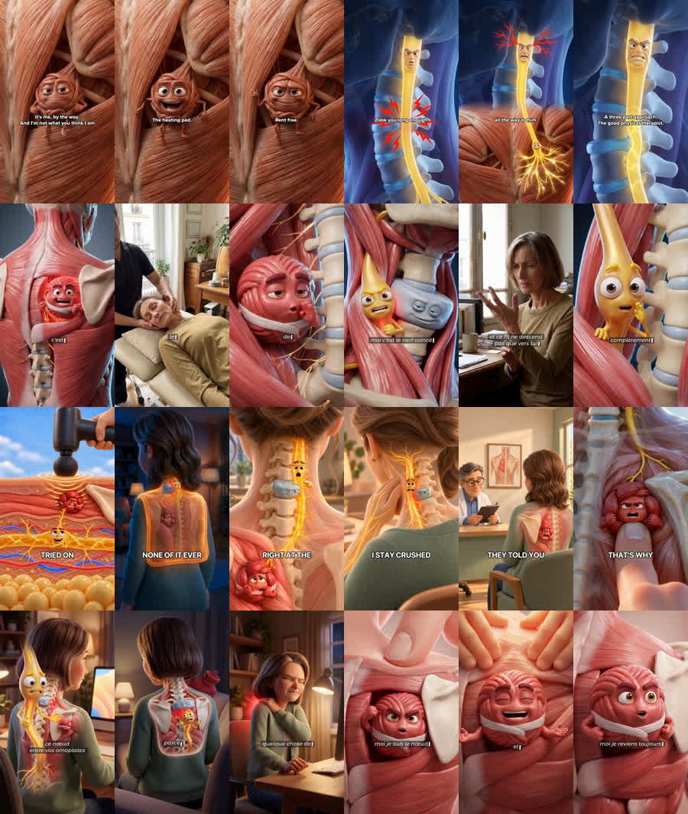

# DoctinoLab (FR) contre Lefaya (DE) : mise à jour du 15 novembre

Produit : coussin de massage cervical 3-en-1 (Cervéa chez DoctinoLab, Theratex chez Lefaya).
Critères : plus de 400 000 vues (pub active ou arrêtée), ou plus de 70 €/jour pendant plus de 5 jours et toujours active.
Source : Trendtrack (toutes les vidéos des deux marques avec au moins 38 000 vues : 11 DoctinoLab, 118 Lefaya),
plus les 55 vidéos DoctinoLab apparues depuis le 8 novembre (téléchargées et transcrites).

## Vérifié directement sur Meta (bibliothèque de pubs, 15 novembre)

- **DoctinoLab** : 181 pubs vidéo actives (310 avec les images). Classées par Meta de la plus vue à la moins vue,
  les **7 premières sont exactement ses 7 gagnantes** (06, 11, 15, 27, 25, 26, 28) : toutes encore actives.
  Ses 53 nouvelles vidéos (8-10 novembre) arrivent à partir de la 27e place : aucune ne les a dépassées.
- **Lefaya** : toutes ses gagnantes sont encore actives et en tête. Meta montre en plus des pubs très vues qui envoient
  vers un **article** (dergesundheitsrat.de) au lieu de la boutique : **une vidéo gagnante de plus** que je n'avais pas
  (« Ich bin der Okzipitalnerv in Ihrem Nacken », 1,33 M de vues). Les autres pubs « article » qui passent les critères
  utilisent la même vidéo que Lefaya 01.
- Meta ne donne pas le nombre de vues : les vues viennent de Trendtrack (DoctinoLab : chiffres du 12 novembre).

## Partie 1 — Les vidéos que DoctinoLab a prises chez Lefaya (gagnantes des deux côtés)

| Lefaya (DE) | DoctinoLab (FR) | Angle | Comment |
|---|---|---|---|
| n° 02 : 7,27 M de vues | n° 15 : 659 000 vues | A — « Ce nœud entre les omoplates n'est pas un muscle, c'est un nerf coincé dans le cou » | Même vidéo, voix et sous-titres traduits |
| n° 03 : 3,66 M de vues | n° 11 : 793 000 vues | D — la démonstration « voilà ce qui arrive quand on s'allonge 15 minutes dessus » | Même vidéo, 1 ou 2 plans changés, « 100 jours » → « 30 jours » |

## Partie 2 — Les vidéos gagnantes faites par DoctinoLab (sans reprendre les images de Lefaya)

| DoctinoLab | Vues | Dépense estimée | Angle | D'où vient l'idée |
|---|---|---|---|---|
| n° 06 | 1,93 M | ≈ 820 €/jour (7 j) | A — nœud = nerf | **Correction : texte ET images d'Artuvate (US, 2 août)**, quelques plans remplacés |
| n° 27 | 294 000 en 8 jours | ≈ 350 €/jour (7 j) | A — le nerf qui parle (« Je suis le nerf de votre cou ») | Idée de Lefaya 10, dessins à lui |
| n° 25 | 289 000 en 8 jours | ≈ 270 €/jour (7 j) | A — « Arrêtez de masser ce nœud… c'est moi » | Idée de Lefaya 16, dessins à lui |
| n° 26 | 270 000 | ≈ 150 €/jour (7 j) | B — « les médecins confondent ça avec la migraine » | Idée de Lefaya 01, montage à lui |
| n° 28 | 156 000 | ≈ 67 à 87 €/jour (7 j), limite | A — nœud = nerf, vraies personnes + anatomie | Idée de Lefaya 16 |

## Partie 3 — Les vidéos gagnantes de Lefaya que DoctinoLab n'a pas utilisées

| Lefaya | Vues | Angle | Statut |
|---|---|---|---|
| **nouvelle (article)** | 1,33 M, 67 jours, ≈ 178 €/jour | B — le nerf d'Arnold qui parle : « Je suis le nerf occipital de votre nuque, et la plupart des médecins passent à côté de moi » | jamais utilisée — [lien Meta](https://www.facebook.com/ads/library/?id=1055275153959199) |
| n° 09 | 1,12 M | F — le kiné raconte une patiente (« Sabine, 50 ans, en télétravail ») | jamais utilisée |
| n° 22 | 389 000 (≈ 71 €/jour) | B — le nerf qui parle : « Ce n'était jamais une migraine. C'est moi. » | jamais utilisée |
| n° 23 | 322 000 (≈ 215 €/jour) | G — beauté : le muscle du cou (SCM) qui donne un double menton et fait vieillir | jamais utilisée |
| ~~n° 12~~ | 731 000 | E — l'histoire du fondateur (« seul contre l'industrie de la santé ») | **reprise le 8 novembre** par DoctinoLab (« un habitant de Paris… »), pas encore de résultats |

**À retenir :** 2 des 4 vidéos allemandes inutilisées sont **« le nerf qui parle » sur la migraine / la base du crâne**.
En France, DoctinoLab fait parler le nerf seulement pour le nœud entre les omoplates (n° 25 et 27).

## Les 7 gagnantes de DoctinoLab : d'où elles viennent (États-Unis, Allemagne ou à lui)

Toutes les 7 sont encore actives sur Meta (15 novembre). Comparaison du texte parlé et des images, vérifiée à l'œil.

| DoctinoLab | Vues | Le texte vient de | Les images viennent de | Conclusion |
|---|---|---|---|---|
| 06 | 1,93 M | 🇺🇸 Artuvate, 2 août (« Here's something most people with a knot between their shoulder blades never find out ») — mot pour mot | 🇺🇸 **la même vidéo Artuvate** (mêmes plans), quelques plans remplacés (bâtiment « doctinolab ») | **copiée des États-Unis** |
| 15 | 659 000 | 🇩🇪 Lefaya 02, elle-même traduite d'Artuvate (15 juillet / 2 août) | 🇩🇪 Lefaya 02 (dessins 3D à Lefaya) | **copiée d'Allemagne** (texte américain à l'origine) |
| 11 | 793 000 | 🇩🇪 Lefaya 03 (démonstration 15 minutes) | 🇩🇪 Lefaya 03 | **copiée d'Allemagne** (pas d'original américain trouvé) |
| 27 | 294 000 | 🇺🇸 Artuvate, 7 octobre (« I'm the nerve in your neck ») — mot pour mot | refaites dans le même style (nerf jaune qui parle) | **texte copié des États-Unis** |
| 25 | 289 000 | 🇺🇸 Artuvate, 26 juillet (« Stop massaging that knot… It's me, by the way ») — mot pour mot | refaites dans le même style (nœud qui parle) | **texte copié des États-Unis** |
| 26 | 270 000 | angle migraine / base du crâne (Artuvate et Lefaya), texte exact pas trouvé | à lui (vraies personnes, médecin, anatomie) | **à lui**, idée reprise |
| 28 | 156 000 | même texte que Nervéa (FR) ; source pas trouvée | à lui (vraies personnes + anatomie) | **à lui** pour les images ; texte probablement américain, pas prouvé |

**Bilan :** 3 copiées des États-Unis (06, 25, 27), 2 copiées d'Allemagne (15, 11), 2 à lui (26, 28).
Bonus : **Lefaya 16** reprend le texte et le style d'images (silhouettes bleues « hologramme ») d'Artuvate du 23 août.

## D'où viennent les 5 vidéos « à lui » de DoctinoLab ? → surtout d'**Artuvate** (États-Unis)

**Artuvate** (artuvate.co, pages Facebook « Health & Science » et « Artuvate ») est une marque américaine qui vend le même
type de coussin. Ses pubs en anglais sont plus anciennes et ont servi de modèle à DoctinoLab **et à Lefaya**.

| DoctinoLab | Source trouvée | Ce qui est repris |
|---|---|---|
| 06 (1,93 M) | Artuvate « Here's something most people with a knot between their shoulder blades never find out » (2 août 2026) — même sujet que Lefaya 02 | texte mot pour mot ; **images de la même vidéo Artuvate** (correction) |
| 27 (294 000) | Artuvate « I'm the nerve in your neck. Nothing you've tried on that knot… has ever reached me » (7 octobre) | texte mot pour mot ; images refaites dans le même style (nerf jaune qui parle) |
| 25 (289 000) | Artuvate « Stop massaging that knot between your shoulder blades. It's me, by the way… rent free » (26 juillet) | texte mot pour mot ; images refaites dans le même style (nœud qui parle) |
| 26 (270 000) | Même sujet et mêmes mots que les pubs Artuvate sur la base du crâne (« misdiagnosed as migraines », tempes, derrière l'œil, muscles sous-occipitaux) | texte exact **pas retrouvé** |
| 28 (156 000) | Même texte que Nervéa (FR), qui dit traduire « notre boutique US » | source anglaise probable, **pas retrouvée** |

**Lefaya copie aussi Artuvate** : Lefaya 02 ← Artuvate 15 juillet ; Lefaya 16 ← Artuvate 23 août (« This is what happens to a
knot in your shoulder blade… ») ; Lefaya 22 « Es war nie eine Migräne. Ich bin es » ← Artuvate 22 juillet (« Alright. I've had it.
I've been trying to talk to you for two years… you pop a migraine pill »).

**La chaîne :** Artuvate (US) → Lefaya (DE) → DoctinoLab (FR). Pour les n° 25 et 27, DoctinoLab est allé **directement** chez
Artuvate (ces textes n'existent pas chez Lefaya).

Complément (bibliothèque Meta, 2 recherches SerpApi) : les 34 pubs actives les plus vues d'Artuvate (produit « PhysioRest »)
ont été transcrites. Elles confirment :
- n° 27 ← Artuvate « I'm the nerve in your neck. That knot between your shoulder blades is where you feel me. It isn't where I am » (7 octobre, 5 versions) ;
- n° 06 / Lefaya 02 ← Artuvate « That knot between your shoulder blades is not a muscle problem… referred nerve pain » (2 août, 2e pub la plus vue) ;
- **Lefaya 08** (« 70 % des maux de tête… pris pour des migraines ») ← Artuvate « Headaches that start at the base of your skull get misdiagnosed as migraines 70% of the time » (9 août) ;
- les « Nous vous devons des excuses… nous avons menti » de Serena (FR) et SereaLab (IT) ← Artuvate « We apologize… because we lied » (5 août).

Limites : 68 pubs Artuvate lues sur 6 778 (le quota Trendtrack de cette connexion est épuisé ; l'espace a encore des crédits,
mais la part « membre » de cette connexion est à zéro). Les sources exactes des n° 26 et 28 n'ont pas été retrouvées.

## Les 53 nouvelles vidéos DoctinoLab (pas encore assez de vues pour tes critères)

Reprises de Lefaya (29) :
- 11 versions du texte « nœud = nerf » (Lefaya 02), de 43 s à 4 min 36 ;
- 11 versions de la démonstration 15 minutes (Lefaya 03), souvent avec une nouvelle accroche au début
  (« On vous a dit que c'était normal à votre âge… », « Vous avez un nœud entre les omoplates ? ») ;
- 4 vidéos migraine / base du crâne / nerf d'Arnold (idée de Lefaya 01) ;
- 3 vidéos du fondateur (Lefaya 12) : la traduction (« un habitant de Paris »), « Je m'appelle Antoine Moreau »,
  « Ma fille avait six ans quand elle m'a dessiné avec la main sur la nuque ».

Nouveaux formats à lui (24) :
- 5 « classements » : « Le pistolet de massage ? Je mets F, direct » (aussi : magnétiseur, dormir sur le ventre, masser au bureau) ;
- 5 histoires de famille : « Maman, freine ! … six semaines avant le mariage de ma fille », « Vous cherchez quoi offrir
  à votre mère pour Noël ? », « mon bras a lâché au moment de soulever Léo, mon petit-fils » ;
- 3 lettres de 5 minutes : « Chère Chloé, lundi à la réunion de 9 h… », « Cher Patrick, dimanche… » ;
- 2 « vu de l'intérieur » : « Ne bougez surtout pas. Je suis dans votre dos et votre nœud est énorme » ;
- 2 « 3 heures du matin, le bras engourdi » ; 3 « comment relâcher ce nœud en 15 minutes » ;
- 1 sketch (« Richard, j'ai dormi… »), 1 test chronométré, 1 « ce n'est pas votre âge, c'est votre cou », 1 « Stop ! Arrêtez de masser ce nœud ».

## Limites

- **Trendtrack n'a plus mis à jour la page de DoctinoLab depuis le 12 novembre** (la bibliothèque de pubs Meta montre
  310 pubs actives le 15 novembre). Les vues de DoctinoLab datent donc du 12 novembre ; les nouvelles vidéos ont pu grossir depuis.
- La dépense est une estimation (environ 9 € pour 1 000 vues). La date de début est le début de diffusion de la pub,
  la vidéo a pu exister avant ailleurs.
- « Même vidéo » (partie 1) a été vérifié à l'œil le 13 novembre. La comparaison d'images automatique ne marche pas sur
  ces vidéos (dessins animés en mouvement, sous-titres traduits) : les reprises de texte ont été trouvées en lisant les transcriptions.
- Une des 55 nouvelles pubs (déjà connue) n'a pas pu être téléchargée.
- Les posts supprimés et Douyin (le TikTok chinois) restent invisibles pour nous.

## Consommation

Trendtrack : environ 410 crédits (il en reste 88 229). SerpApi : 9 recherches (il en reste 165 sur 250).
