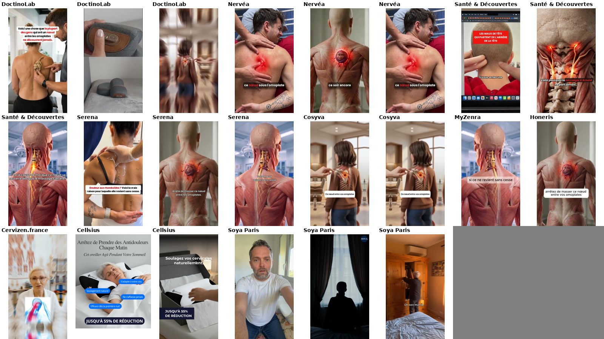
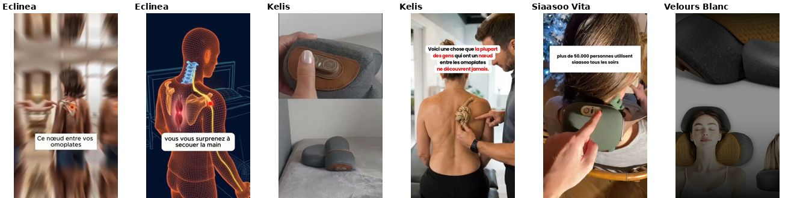

# Concurrents français du coussin cervical 3-en-1 avec des pubs actives (18 novembre 2026)

Produit : le coussin cervical 3-en-1 (étirement, chaleur, vibrations) vendu par Nucalis.
Source : bibliothèque de pubs Meta via SerpApi (pubs **actives**, diffusées en France).
Trendtrack était bloqué (part de crédits de la connexion à zéro), donc **pas de vues ni de dépense**.

## Les concurrents (même coussin, pubs actives aujourd'hui)

| Concurrent | Boutique | Pubs actives | Depuis | Nouveautés |
|---|---|---|---|---|
| **DoctinoLab** (« Cervéa ») | https://doctinolab.fr/products/cervea-appareil-de-massage-cervical-3-en-1 | **387** | 14 octobre | aucune nouvelle pub dans son top 30 depuis le 11 novembre |
| **Nervéa** (pages « Nervéa » + « Santé & Découvertes ») | https://anchored.fr/shop/nervea/coussin-cervical-chauffant/ | **255 + 119** | 13 octobre | 8 nouvelles depuis le 11 novembre ; beaucoup de pubs vers des articles « 5 raisons » |
| **Cosyva** (« CerviRelax ») | https://cosyva.com/products/cervirelax | **132** | 1er octobre | vend aussi en Allemagne (https://cosyva.com/de/products/cervirelax-nackenmassagekissen) |
| **Honeris** (« HoneRelax ») | https://honeris.com/products/honerelax-appareil-massage-3en1 | **25** | **16 novembre** | **nouveau** : 25 pubs lancées en 2 jours (test) |
| **MyZenra** (« Nuquéa ») | https://myzenra.com/ | **9** | 6 novembre | nouveau, petit test |
| **Serena** | https://my-serena.com/products/soulagez-vos-douleurs-cervicales-vos-tensions-a-la-nuque-et-vos-maux-de-tete-sans-medicament-en-seulement-15-minutes-par-jour | 418 (surtout pour un **autre** appareil, le dos) | — | quelques pubs « nuque » relancées depuis le 14 novembre |

Écartés (autre produit) : Cervizen, Cellsius, Soya Paris, Somnilys (oreillers en mousse), Auvane (produit contre une
« carence », arthrose / fibromyalgie), myvitality (appareil pour le nerf vague).

**À retenir :** tous ces concurrents passent les **mêmes pubs** (le nerf jaune et le nœud rouge qui parlent, « Arrêtez de
masser ce nœud entre vos omoplates », le témoignage « Martin G. »), copiées des pubs américaines d'Artuvate.

## Recherche élargie (16 recherches de plus)

**Nouveaux vendeurs du même coussin (pubs actives) :**

| Concurrent | Boutique | Depuis | Ce qu'on voit |
|---|---|---|---|
| **Eclinea** (« Theratex masseur 3 en 1 » !) | https://eclinea.com/products/theratex-masseur3en1 | 24 octobre | reprend le nom « Theratex » de Lefaya et ses images « hologramme » |
| **Kelis** | https://kelislaboutique.com/products/appareil-de-massage-cervicale-3-en-1 | 15 novembre | **mêmes images que DoctinoLab** (n° 06) |
| **NTPCustom** (« NTPNeck ») | https://ntpcustom.com/products/ntpneck-coussin-cervical | 16 novembre | « coussin cervical 3-en-1, chaleur, vibrations » (image non vérifiée) |
| **Velours Blanc** | https://veloursblanc.fr/ | 14 novembre | coussin chauffant qui ressemble au même (probable) |

Nombre exact de pubs actives de ces 4 : non compté (il faut 1 recherche par boutique).

**Anciennes boutiques revérifiées :** SOFELA, Lavyra, CerviDos, Cerymia, Calmeo, Soleria et Sereva n'ont **plus aucune pub active** ;
Florelya fait de la pub uniquement pour des produits pour chiens.

**Écartés :** Siaasoo (masseur en U autour du cou, autre produit), Chillow, Koanna, Beurer, Miravita, Cervizen, Cellsius, Soya, Somnilys.

## Limites

- Meta (par SerpApi) ne donne **ni les vues ni la dépense** : impossible de dire ici quelles pubs passent les critères
  (400 000 vues, ou plus de 70 €/jour pendant 5 jours). Il faut Trendtrack.
- Les sites des concurrents affichaient une vérification anti-robot : le produit a été vérifié avec les images de leurs pubs.
- La recherche par mots-clés montre au plus 30 pubs par mot : un petit concurrent peut manquer.
- La date de début est le début de diffusion de la pub sur Meta.

## Consommation

SerpApi : 29 recherches (14 par mots-clés + 15 par page). Il en reste 128 sur 250. Trendtrack : 0 (bloqué).
